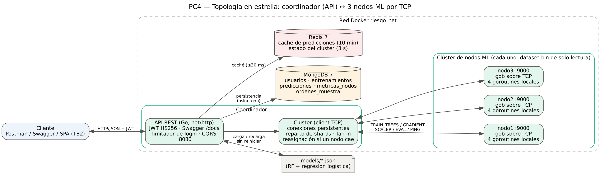

# RiesgoGo — Predicción de Contrataciones y Riesgo en Compras Públicas (Perú, 2026)

**CC65 – Programación Concurrente y Distribuida · UPC · Trabajo Final · Caso N.° 4** · Grupo 4
Entregables: **PC3** (carga y entrenamiento concurrente) y **PC4** (clúster distribuido, API, bases de datos).

Sistema en **Go** que carga, limpia y procesa de forma concurrente **2.32 millones de órdenes de compra y servicio del Estado** (OSCE / SEACE, enero–septiembre 2026, Portal de Datos Abiertos del Perú), entrena modelos de clasificación binaria **distribuidos entre nodos TCP** y los expone por una **API REST** para **detectar órdenes con alto riesgo de sobrecosto o anulación**.

> **Pregunta de impacto social:** *¿Qué órdenes de compra pública —y en qué entidades y regiones— tienen mayor riesgo de sobrecosto o anulación, para que los órganos de control (Contraloría, OCI, OECE) prioricen su revisión antes de que se comprometa y gaste el dinero público?*

## Resultados

| Indicador (PC3, laptop de 16 hilos) | Valor |
|---|---|
| Filas leídas / válidas | 2,324,083 / 2,320,035 |
| Duplicados eliminados / rechazos | 3,970 / 78 |
| Órdenes en riesgo (etiqueta) | 171,444 (7.39 %) |
| Random Forest (100 árboles, 16 workers) — test 463,800 órdenes | ROC-AUC 0.951 · AP 0.802 · F1 0.734 · entrena en 1.79 s |
| Regresión logística (SGD data-parallel) | ROC-AUC 0.907 · F1 0.590 · entrena en 0.55 s |
| Revisión del top 10 % (RF) | captura el 80.7 % de las órdenes en riesgo (lift 8.07) |
| Speedup con 16 workers | RF 4.53x · regresión logística 6.44x · carga ETL 4.68x |
| `go test -race` | pruebas OK, 0 condiciones de carrera |

| Indicador (PC4) | Evidencia |
|---|---|
| Clúster | 3 nodos TCP + coordinador; reparto por shards, reasignación si un nodo cae |
| API | REST + JWT + Swagger (`/docs`); `/predict` con latencia p99 < 100 ms (`cmd/apibench`, Postman) |
| Bases de datos | MongoDB (5 colecciones) + Redis (caché) |
| Pruebas | `internal/cluster` e `internal/api` con `-race`; colección Postman en `docs/postman/` |

## Arquitectura PC4



- **Topología en estrella**: el coordinador (API) mantiene una conexión TCP persistente con cada nodo; no hay tráfico entre nodos.
- **Protocolo**: solicitud/respuesta con `encoding/gob` sobre TCP (`internal/cluster/proto.go`).
- **Tolerancia a fallos**: todos los nodos cargan el dataset (solo lectura) y derivan los mismos shards, así que una tarea de un nodo caído se reasigna a otro.
- Detalle del flujo de entrenamiento: `docs/img/diag_pc4_protocolo.png`; entidades: `docs/img/diag_pc4_entidades.png`.

## Estructura

```
cmd/
  loader/      PC3 · Parte A: XLSX → limpieza → dedup → features → EDA (concurrente)
  train/       PC3 · Parte B: Random Forest y regresión logística en paralelo + benchmarks
  node/        PC4 · nodo ML: servidor TCP que entrena árboles / calcula gradientes / puntúa
  clusterctl/  PC4 · cliente del coordinador: estado del clúster y entrenamiento distribuido
  api/         PC4 · API REST (JWT, Swagger, predicciones, entrenamiento, métricas)
  apibench/    PC4 · prueba de carga de /predict (p50/p95/p99)
  seed/        PC4 · carga la muestra de órdenes en MongoDB
  xlsx2csv/    herramienta auxiliar: convierte los XLSX a CSV crudo
internal/
  xlsx/ etl/ eda/ ml/         PC3 (lector XLSX, limpieza, features, modelos)
  cluster/     PC4 · protocolo, nodo, coordinador, tolerancia a fallos
  api/         PC4 · servidor HTTP, JWT, modelos, jobs, openapi.yaml
  store/       PC4 · entidades y contratos Repo/Cache (+ implementación en memoria)
  mongostore/  PC4 · adaptador MongoDB       redisstore/  PC4 · adaptador Redis
docs/          diagramas (.dot + img/), kanban.md, postman/
reports/       evidencias JSON/TXT   data/sample/  muestra de 20,000 órdenes
```

## Cómo ejecutar (PC4)

Requisitos: Go 1.24+, Docker Desktop, `data/processed/dataset.bin` (lo genera el loader de la PC3).

```bash
go mod tidy                       # una vez: completa go.sum (drivers de MongoDB y Redis)
go test -race ./internal/...      # pruebas del clúster y de la API

docker compose build api && docker compose up -d   # MongoDB, Redis, 3 nodos y la API (los nodos tardan ~30 s en cargar)
docker compose ps
docker compose --profile tools run --rm seed      # órdenes de muestra → MongoDB

# Swagger:   http://localhost:8080/docs
# Usuarios:  admin / admin123 (admin)   analista / analista123 (analista)
go run ./cmd/apibench -url http://localhost:8080 -n 5000 -c 32     # latencia de /predict
```

Entrenar en el clúster (sin Docker, 3 terminales para los nodos):

```bash
go run ./cmd/node -id nodo1 -listen :9001 -data data/processed/dataset.bin
go run ./cmd/node -id nodo2 -listen :9002 -data data/processed/dataset.bin
go run ./cmd/node -id nodo3 -listen :9003 -data data/processed/dataset.bin
go run ./cmd/clusterctl status
go run ./cmd/clusterctl -trees 60 -depth 14 train
```

### PC3 (sin cambios)

```bash
go run ./cmd/loader -in data/raw -out data/processed
go run ./cmd/train  -data data/processed/dataset.bin -trees 100 -depth 16 -epochs 5
go test -race -v ./...
docker compose --profile etl up loader trainer
```

## Git Flow

- `main`: versiones entregadas (tags `v0.3.0-pc3`, `v0.4.0-pc4`, `v1.0.0-tb2`)
- `develop`: integración
- `feature/*`: una rama por tarea del tablero Kanban, merge con Pull Request a `develop`

## Próximo entregable

- **TB2:** SPA (React) con login, dashboard de impacto, simulación de predicciones y panel de métricas del clúster; WebSocket; políticas de seguridad de la API; evaluación experimental.
